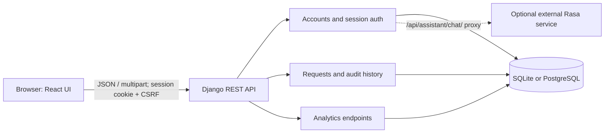
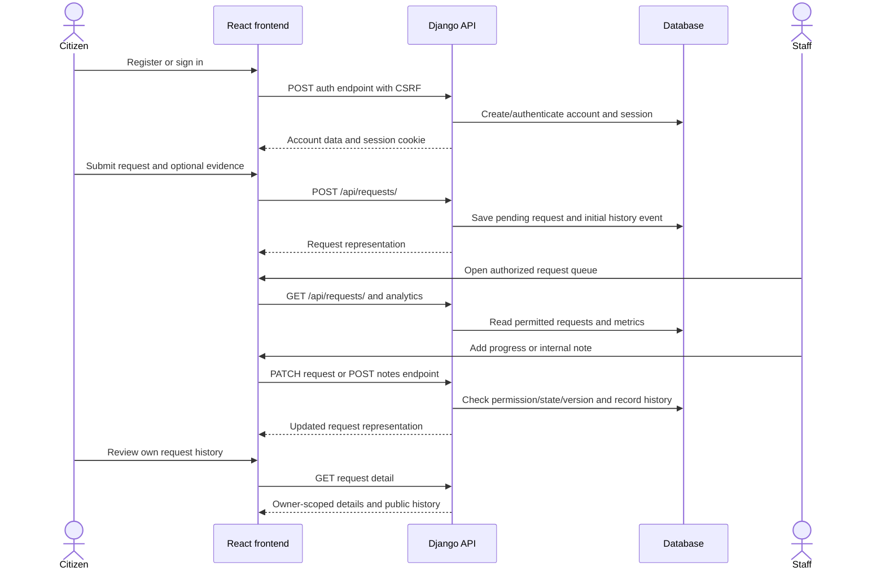

# System Documentation

## 1. Introduction

The Public Service Request System is a browser-based portal for reporting community service issues. Citizens can create an account, submit a request, and see the request's status and public progress history. Authorized staff can review requests across users, record progress, add internal notes, and view service analytics.

## 2. Problem statement

Community concerns require a consistent way to capture issue details and location, route them into a review queue, and communicate progress to the person who reported them. This system provides account-scoped submissions, staff review, and an audit history. It does not implement operational department assignment or external notifications.

## 3. Objectives

- Provide authenticated submission of service requests with descriptive details and optional image evidence.
- Let a citizen view only their own requests and citizen-visible history.
- Give explicitly authorized staff a shared request queue and request status controls.
- Record status changes, actors, timestamps, and update notes.
- Provide account-scoped and staff-wide database analytics.
- Protect state-changing requests using session authentication and CSRF checks.

## 4. Scope

### Included

- Registration, login, logout, and current-account lookup.
- Request creation, list, and detail views.
- Statuses `pending`, `in_progress`, and `resolved`.
- Staff request search, filters, pagination, and sorting.
- Public progress updates, internal staff notes, and status history.
- Optional image upload, limited to JPEG, PNG, or WebP and 5 MB.
- Citizen and administrator dashboards.
- A Django admin site with read-only request and status-history records.
- An authenticated assistant-chat proxy endpoint to a configured Rasa service.

### Not implemented or not verified

- Department or staff assignment, request deletion, and a rejected status.
- Email, SMS, or in-app notification delivery.
- Password reset/recovery workflows.
- Production object storage or a production deployment configuration.
- The external Rasa assistant service itself. The Django proxy exists, but the service is outside this workspace and cannot be verified here.

## 5. Users and permissions

| User | Capabilities |
| --- | --- |
| Anonymous visitor | View the public landing page; register or log in. |
| Citizen account | Create requests; view own requests and public progress; view own analytics; use the assistant proxy endpoint. |
| Staff with `is_staff` and `requests_api.view_servicerequest` | View the all-request queue and staff analytics. |
| Staff with `is_staff` and `requests_api.change_servicerequest` | Perform the view capabilities plus status/progress changes and internal notes. |
| Superuser | Django's normal permission bypass, including staff portal capabilities. |

The public registration endpoint does not accept account-role elevation. The Django admin provides role and permission administration; it does not provide request mutation/deletion.

## 6. Requirements

### Functional requirements

1. A visitor can register with a name, email, phone number, and password.
2. An account can authenticate and maintain a server-side Django session.
3. An authenticated citizen can submit a request with a title, category, description, location, and optional image.
4. A citizen can list and open only their own requests.
5. Authorized staff can view and filter all requests.
6. Authorized staff can advance requests from pending to in progress, then to resolved.
7. A resolution must include a citizen-visible progress note.
8. Authorized staff can add staff-only notes.
9. The system records request status-history events and prevents stale concurrent updates.
10. A citizen can view personal summary statistics; authorized staff can view overall analytics.

### Non-functional/security requirements evidenced by the implementation

- Cookie-based session authentication, `HttpOnly` session cookies, and CSRF protection for unsafe methods.
- Explicit CORS and CSRF trusted-origin configuration.
- Server-side ownership and staff permission checks.
- Password validation using Django's configured validators and Django password hashing.
- Pagination on request lists: default 10, maximum 50.
- Upload validation for image format and size.
- Request history hides internal notes from users without change permission.

## 7. System architecture

The React frontend is served by Vite in development. Django serves `/api/` routes; the API uses Django REST Framework with `SessionAuthentication`. Django settings select SQLite when `DB_ENGINE` is unset or `sqlite`, and PostgreSQL for a non-SQLite engine configuration.

## 8. Modules and data model

### `accounts`

- Uses Django's built-in user model and a one-to-one `CitizenProfile` with full name, email, and phone.
- Provides CSRF bootstrap, register, login, logout, current-account, and assistant proxy routes.
- Provides account capability flags derived from staff state and model permissions.

### `requests_api`

- `ServiceRequest`: UUID, title, category, description, location, owner, status, optional evidence image, and timestamps.
- `RequestStatusUpdate`: request, prior/current status, actor, note, internal/public flag, and timestamp.
- Enforces owner-scoped citizen access, staff permission checks, allowed state transitions, and optimistic concurrency checks.
- Exposes request list/detail/create/update and internal-note operations.

Categories are roads and transport, water and sanitation, waste management, street lighting, public safety, and other. Status values are `pending`, `in_progress`, and `resolved`.

### `analytics_api`

- `/dashboard/` aggregates only the authenticated account's data.
- `/admin-dashboard/` provides staff analytics and recent request summaries without requester contact details.

### `frontend`

- React single-page interface with public landing/authentication screens, citizen request screens, and staff overview, queue, and analytics views.
- `src/api.js` includes cookies on API calls, obtains a CSRF token before unsafe methods, and translates error responses.

## 9. System workflow

Request status transitions are strictly `pending → in_progress → resolved`. A resolved request cannot be reopened through the API. Staff updates send the request's current `updated_at` as `expected_updated_at`; the server rejects stale values with HTTP 409.

## 10. Operational considerations

- Use `backend/.env.example` as a variable-name reference, not as production configuration.
- Verify the selected database before applying migrations. Preserve the unrelated `pesa` database.
- `DEBUG` defaults to true when not configured; the Django development server must not be treated as a production server.
- Local media storage is used. Production deployment needs durable storage and deliberate media access controls.
- See [Installation Guide](installation-guide.md), [API Documentation](api-documentation.md), and [Testing Documentation](testing-documentation.md) for operational detail.
